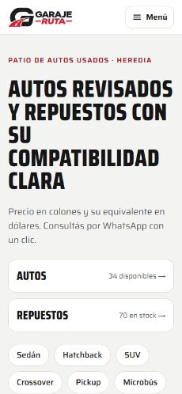
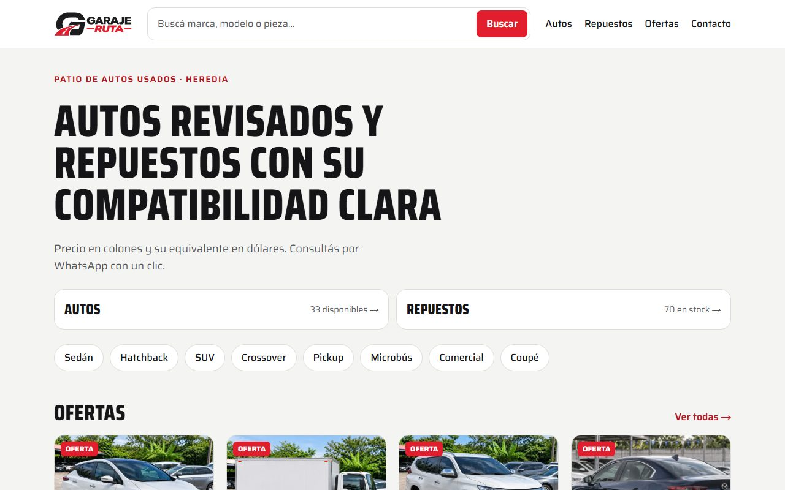
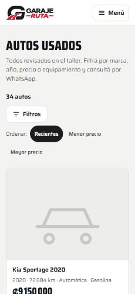
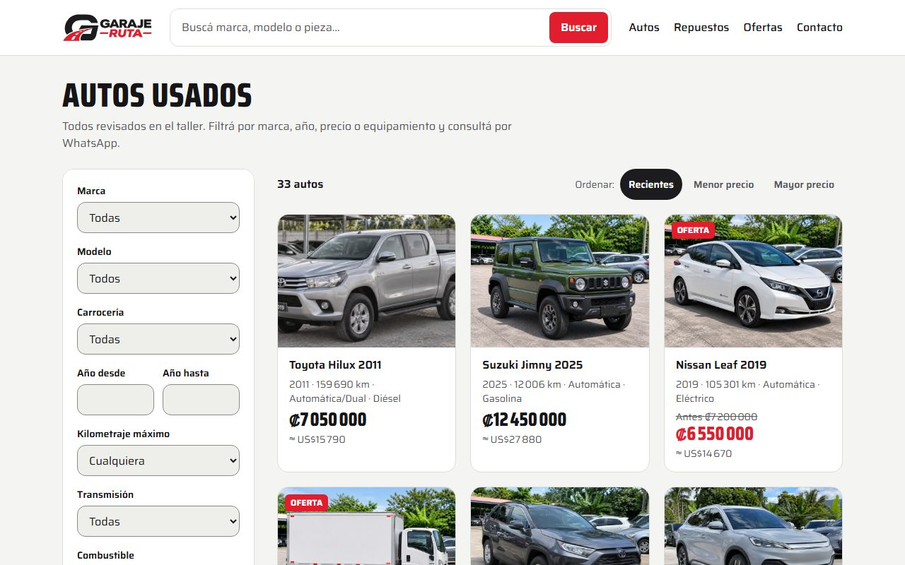
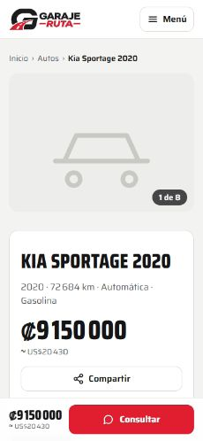
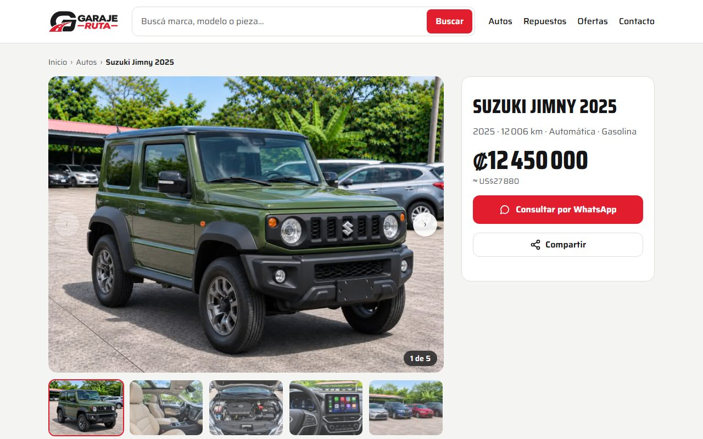
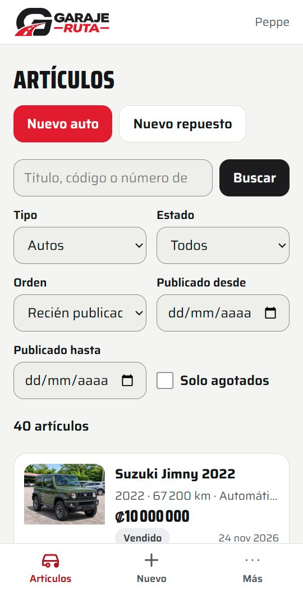
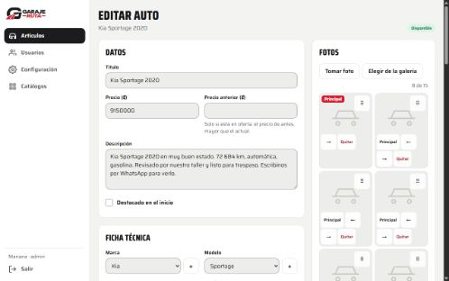

# Garaje Ruta

Catálogo web y panel de administración para **Garaje Ruta**, un patio en Heredia que vende autos usados y repuestos.

> **Negocio ficticio.** Los autos, repuestos, precios y fotos son de ejemplo (las fotos se generaron con IA). Proyecto de portafolio.

**Demo:** [garajeruta.marcovinir.dev](https://garajeruta.marcovinir.dev)

> **Probalo por dentro**
>
> - **Panel:** [garajeruta.marcovinir.dev/gestion-garajeruta](https://garajeruta.marcovinir.dev/gestion-garajeruta)
> - **Usuario:** `demo@garajeruta.test`
> - **Clave:** `Demo-Garaje-2026`
>
> El usuario demo ve todo el panel pero no puede cambiar nada. Los datos de ejemplo se reinician los lunes y jueves (los usuarios invitados desde el panel se borran).

El patio publicaba todo en Facebook Marketplace. Este proyecto le da un canal propio:

- una **web pública tipo catálogo**, renderizada en el servidor, cuyos enlaces se ven con foto, título y precio al compartirlos en WhatsApp o Facebook, con el botón «Consultar por WhatsApp»;
- un **panel privado** para publicar y administrar desde el celular (y también cómodo en tablet y escritorio).

## Stack

- **Frontend:** Next.js 16 (App Router, Cache Components) + React + TypeScript + Tailwind CSS.
- **Backend:** Django 5.2 + Django REST Framework + PostgreSQL.
- **Producción:** Vercel (dos proyectos: frontend y backend), Supabase Postgres, Cloudinary (fotos) y Resend (correo).
- **Desarrollo:** Docker Compose (Django + PostgreSQL 18).

## Web pública

Inicio, listados de autos y repuestos con filtros en la URL (se comparten por WhatsApp tal cual), búsqueda tolerante a errores («corola» encuentra el Corolla), ficha con galería y Open Graph, página de «ya se vendió» con similares, `sitemap.xml` y `robots.txt`. Precio en colones y, debajo, su equivalente en dólares.

|         | Celular (360 px)                                                                         | Escritorio (1280 px)                                                                                  |
| ------- | ---------------------------------------------------------------------------------------- | ----------------------------------------------------------------------------------------------------- |
| Inicio  |           |                       |
| Listado |  |  |
| Ficha   |  |              |

**Vista previa al compartir:** cada ficha lleva `og:title` (el auto), `og:description` (precio, año, kilometraje, transmisión y combustible) y `og:image` de 1200×630 recortada por Cloudinary. Los metadatos van siempre en el `<head>` (`htmlLimitedBots: /.*/`), también para rastreadores que Next no conoce.

## Panel

- **Listado:** tarjetas en el celular y tabla en escritorio, con filtros en la URL.
- **Acciones rápidas:** «Vendido» o «Vendí 1», reservar, ocultar, duplicar, eliminar y compartir. Las que cambian la web o las ventas piden confirmación, y la venta se puede deshacer desde el aviso.
- **Formulario de autos y repuestos:** las fotos se comprimen en el navegador y suben directo a Cloudinary, se reordenan y la primera es la principal.
- **Usuarios** con roles (admin, colaborador y demo de solo lectura) e invitación por correo; **configuración** del negocio (WhatsApp, dirección, horario) y **catálogos**.

|            | Celular (360 px)                                                                                         | Escritorio (1280 px)                                                                                          |
| ---------- | -------------------------------------------------------------------------------------------------------- | ------------------------------------------------------------------------------------------------------------- |
| Listado    |         |  |
| Formulario |  |      |

## Arquitectura

```
          Navegador · WhatsApp · Facebook · Google
                           │
                           ▼
   Vercel · frontend (Next.js)
     • /, /autos, /repuestos, /autos/[slug]…  → renderizado en servidor con caché por etiquetas
     • /gestion-…/*                            → panel: React en el navegador
     • /api/v1/*  → rewrite (mismo origen) ──────┐
                           │ servidor a servidor  │
                           ▼                      ▼
   Vercel · backend (Django + DRF, función Python)
     • API REST, sesiones + CSRF, permisos, firma de subida
                │                          │
                ▼                          ▼
   Supabase Postgres (pooler)     Cloudinary (fotos)
                ▲
   GitHub Actions: migrar · resembrar · respaldo · tipo de cambio
```

El rewrite de `/api/v1/*` hace que el navegador vea un solo dominio: la cookie de sesión de Django (`HttpOnly`, `Secure`, `SameSite=Lax`) y el CSRF funcionan sin CORS.

## Decisiones técnicas

- **Next 16 con `'use cache'` y etiquetas que Django revalida.** Las páginas públicas leen Django desde el servidor con `cacheTag`. Cuando el panel guarda un cambio, Django llama a `POST /api/revalidar` (con un secreto compartido) con las etiquetas afectadas: un auto vendido sale del inicio, los listados y el sitemap en menos de un minuto. Si esa llamada falla, el cambio se guarda igual y solo queda en el log.
- **308 y 404 reales en `proxy.ts`.** Con Cache Components una página siempre empieza a responder con 200, así que la redirección de una ficha con el texto viejo en la URL (308 a la canónica) y el 404 de una que no existe se deciden antes, en el proxy.
- **«Vendí 1» sin vender de más.** La venta bloquea la fila con `SELECT … FOR UPDATE`; si otra persona vendió la última unidad, responde 409 y el panel muestra el mensaje y actualiza la fila. «Deshacer» desde el aviso deshace esa venta y no la última del artículo.
- **Fotos firmadas directo a Cloudinary.** Django firma la subida y el navegador sube la foto ya comprimida, sin pasar por la función de Vercel (límite de 4,5 MB por petición). Quitar una foto mientras sube cancela la subida.
- **Modelo en 3FN.** Artículo con subtipos auto y repuesto, catálogos (marcas, modelos, carrocerías, equipamiento, categorías de piezas en árbol), compatibilidad de repuestos por modelo y rango de años, ventas, vistas diarias e historial de cambios. Las tablas de historial y vistas existen desde el principio para no migrar después.
- **Permisos por código y ruta del panel configurable.** Cada vista exige permisos (`articulos.editar`, `ventas.registrar`…) que se asignan a roles. El panel vive en una ruta que se elige al desplegar (`NEXT_PUBLIC_PANEL_RUTA`): `/panel` responde 404 y el panel lleva `X-Robots-Tag: noindex`. Esto solo reduce el ruido de bots; la seguridad son los permisos de la API.
- **Precio en dólares con tipo de cambio diario.** El precio se guarda en colones. Un workflow diario guarda el tipo de cambio y la web muestra el equivalente con su fuente. El del Banco Central queda pendiente ([#47](https://github.com/marcovinir/garaje-ruta/issues/47)); mientras tanto se usa [ExchangeRate-API](https://www.exchangerate-api.com) (open.er-api.com).
- **Límites de peticiones.** Login 10 por minuto y API pública 120 por minuto por IP, detrás del proxy de Vercel (`NUM_PROXIES=1`, probado en producción). El servidor de Next se identifica con un encabezado secreto y no cuenta para el límite.

## Pruebas

| Tipo                                      | Cantidad      | Cómo correrlas                                      |
| ----------------------------------------- | ------------- | --------------------------------------------------- |
| Backend (pytest)                          | 307           | `docker compose run --rm backend pytest -q`         |
| Frontend (Vitest + Testing Library + MSW) | 251           | `cd frontend && npm test`                           |
| E2E (Playwright, celular y escritorio)    | 6 pruebas × 2 | `cd frontend && npm run e2e` con el stack levantado |

El CI de GitHub corre las tres en cada PR, más Lighthouse CI. La rama `main` está protegida: todo entra por PR con el CI en verde.

Las E2E cubren publicar un auto con fotos (HU-01), la ficha con Open Graph y WhatsApp (HU-02/03), la redirección 308 y el 404, vender y deshacer (HU-04), y que el encabezado no se rompa al desplazarse. La de la ficha también corre contra producción, solo leyendo: `E2E_URL=https://garajeruta.marcovinir.dev npx playwright test ficha.spec.ts`.

## Lighthouse

Producción, perfil de celular, mediana de 3 corridas (24 nov 2026):

| Página       | Rendimiento | Accesibilidad | Buenas prácticas | SEO |
| ------------ | ----------- | ------------- | ---------------- | --- |
| Inicio       | 100         | 100           | 100              | 100 |
| `/autos`     | 87          | 100           | 100              | 100 |
| `/repuestos` | 89          | 100           | 100              | 100 |
| Ficha        | 83          | 100           | 100              | 100 |

En el CI, Accesibilidad ≥ 90 y SEO ≥ 95 bloquean el PR; Rendimiento y Buenas prácticas solo avisan, porque varían con la máquina. En el panel, Accesibilidad 100 en el login, el listado, el formulario y los usuarios.

## Respaldo

- **Diario:** el de Supabase, incluido en el plan gratis.
- **Semanal propio:** el workflow `respaldo.yml` hace `pg_dump` los domingos, lo **cifra** con GPG y lo guarda 30 días como artefacto de GitHub. Vive fuera de Supabase y se puede restaurar en cualquier Postgres. Como el repo es público (cualquier cuenta de GitHub puede descargar sus artefactos), va cifrado y sin los datos de sesiones ni de caché.
- **Restauración probada** el 24 nov 2026: el respaldo se restauró en una base aparte, con los conteos de producción, y Django corrió contra ella sin migraciones pendientes. El procedimiento está en [`docs/respaldo.md`](docs/respaldo.md).

## Limitaciones

- **Supabase gratis se pausa** tras una semana sin uso. El resembrado de lunes y jueves lo mantiene activo.
- **Workflows programados:** en un repo público, GitHub los desactiva tras 60 días sin actividad. Si pasa, se reactivan desde _Actions_ (o con cualquier commit).
- **El reinicio de lunes y jueves borra los usuarios invitados** desde el panel; el admin, el colaborador y el demo se conservan, igual que la configuración del negocio.
- **Funciones frías de Vercel:** la primera petición después de un rato sin visitas tarda más.
- **Tipo de cambio:** el oficial del BCCR queda pendiente en [#47](https://github.com/marcovinir/garaje-ruta/issues/47).
- **Solo 17 modelos tienen foto propia:** los autos de ejemplo se reparten entre ellos para que la foto coincida con la ficha (ver [`docs/fotos-ejemplo.md`](docs/fotos-ejemplo.md)).

## Desarrollo local

Requisitos: Docker Desktop y Node 24.

```bash
docker compose up -d                                        # PostgreSQL 18 (puerto 5433) y Django (8000)
docker compose run --rm backend python manage.py migrate
docker compose run --rm backend python manage.py sembrar    # datos de ejemplo
docker compose run --rm backend pytest -q                   # pruebas del backend

cd frontend
npm install
npm run dev                                                 # http://localhost:3000 (panel en /panel)
npm test
```

En desarrollo, `sembrar` crea `admin@garajeruta.test` y `colaborador@garajeruta.test` con la clave local `Local-Garaje-2026`, y el demo con `Demo-Garaje-2026`. Fuera de desarrollo exige `SEMILLA_PASSWORD` (secreta) y nunca usa la clave local.

Para ver las fotos de ejemplo en local, poné `CLOUDINARY_URL` en `backend/.env` y `NEXT_PUBLIC_CLOUDINARY_CLOUD` en `frontend/.env.local`.

**Revalidación en local:** poné el mismo `REVALIDACION_SECRETO` en `frontend/.env.local` y pasáselo a Django al ejecutar el cambio (dentro del contenedor, Next está en `host.docker.internal`):

```bash
docker compose exec -e REVALIDACION_SECRETO=<el mismo> -e FRONTEND_URL=http://host.docker.internal:3000 backend python manage.py shell
```

**Ruta del panel:** `NEXT_PUBLIC_PANEL_RUTA` se inyecta al compilar. En Git Bash hay que compilar con `MSYS_NO_PATHCONV=1`; si no, `/gestion-9x2` se convierte en una ruta de Windows.

**Capturas de este README:** `frontend/e2e/capturas.spec.ts`, que se corre a mano con `CAPTURAS=1` (instrucciones en el archivo).

La hoja de ruta está en la issue [#1](https://github.com/marcovinir/garaje-ruta/issues/1) y el diseño en [`docs/superpowers/specs/`](docs/superpowers/specs/).
