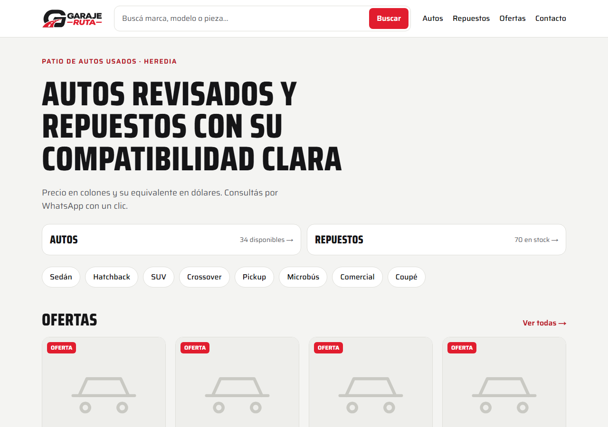
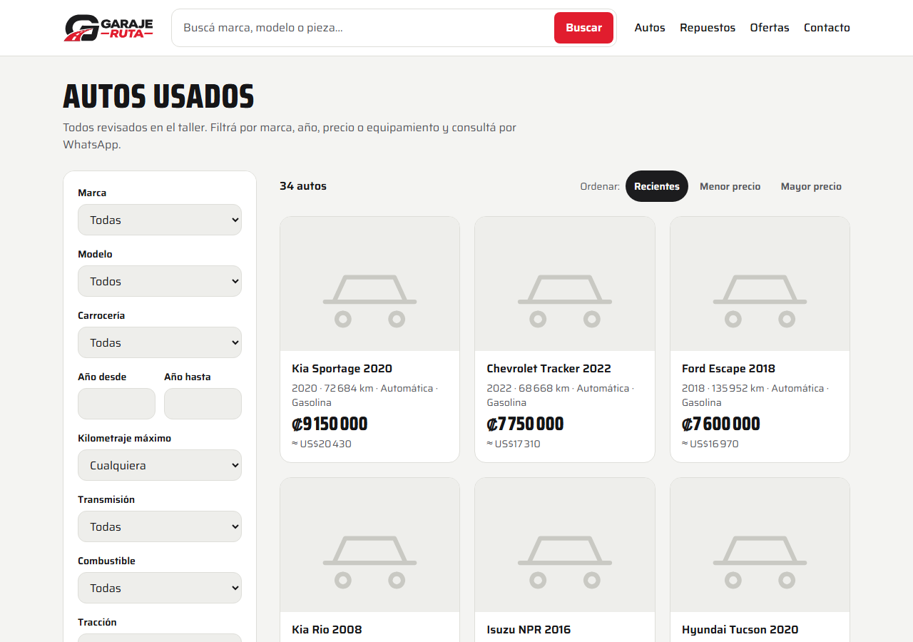
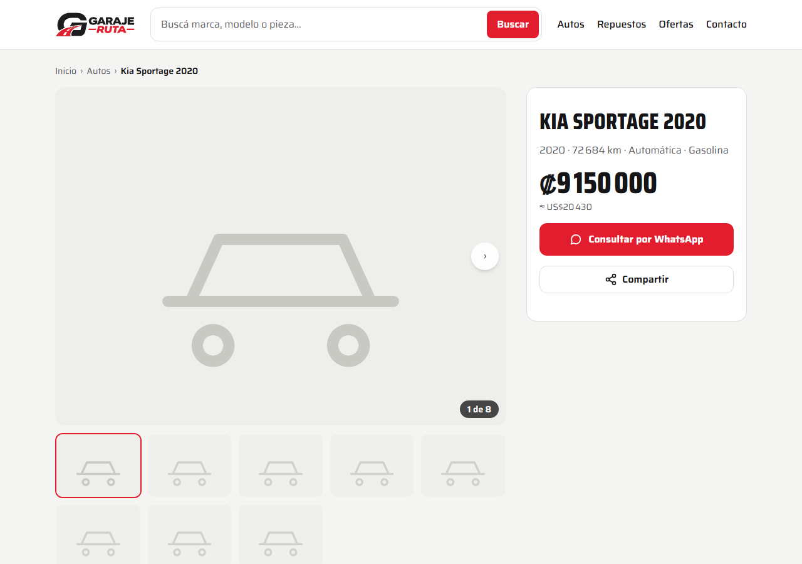
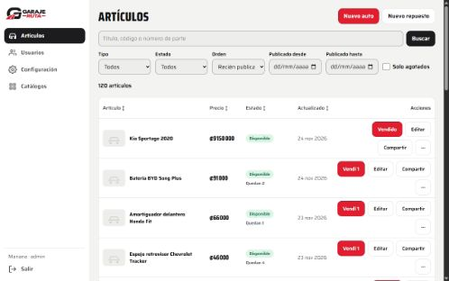
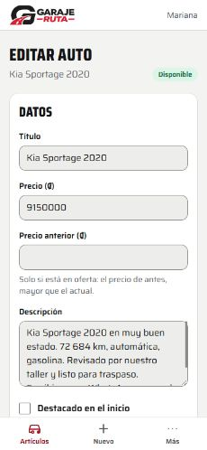

# Garaje Ruta

Catálogo web y panel de administración para **Garaje Ruta**, un patio que vende autos usados y repuestos.

> **Negocio ficticio.** Todos los datos (autos, repuestos, precios, teléfonos) son de ejemplo. Proyecto de portafolio.

El patio publicaba todo en Facebook Marketplace. Este proyecto le da un canal propio:

- una **web pública tipo catálogo**, renderizada en el servidor, cuyos enlaces se ven con foto, título y precio al compartirlos en WhatsApp o Facebook, con el botón «Consultar por WhatsApp»;
- un **panel privado** para publicar y administrar desde el celular (y también cómodo en tablet y escritorio).

## Stack

- **Frontend:** Next.js (App Router) + React + TypeScript + Tailwind CSS.
- **Backend:** Django 5.2 + Django REST Framework + PostgreSQL.
- **Fotos:** Cloudinary. **Despliegue:** Vercel + Supabase.
- **Desarrollo:** Docker Compose (Django + PostgreSQL).

## Cómo correrlo

Requisitos: Docker Desktop y Node 24.

```bash
docker compose up -d                                        # PostgreSQL 18 (puerto 5433) y Django (8000)
docker compose run --rm backend python manage.py migrate
docker compose run --rm backend python manage.py sembrar    # datos de ejemplo
docker compose run --rm backend pytest -q                   # pruebas del backend

cd frontend
npm install
npm run dev                                                 # http://localhost:3000
npm test
```

Usuario de demostración (solo lectura): `demo@garajeruta.test` / `Demo-Garaje-2026`.

En desarrollo, `sembrar` crea además `admin@garajeruta.test` y `colaborador@garajeruta.test` con la clave local `Local-Garaje-2026`. Fuera de desarrollo exige `SEMILLA_PASSWORD` (secreta) y nunca usa esa clave.

## Web pública

Inicio, listados de autos y repuestos con filtros en la URL (se comparten por WhatsApp tal cual), búsqueda, ficha con galería y Open Graph, página de «ya se vendió» con similares, `sitemap.xml` y `robots.txt`. Precio en colones y, debajo, su equivalente en dólares.

|         | Celular (360 px)                                                                         | Escritorio (1280 px)                                                                                  |
| ------- | ---------------------------------------------------------------------------------------- | ----------------------------------------------------------------------------------------------------- |
| Inicio  |           |                       |
| Listado |  |  |
| Ficha   |  |              |

Las fotos salen como marcador gris hasta que se cargan las de ejemplo en Cloudinary.

**Lighthouse móvil** (build de producción en local, 24 nov 2026): Accesibilidad, SEO y Buenas prácticas en **100** en inicio, listados y ficha. Rendimiento entre **70 y 90** según la corrida: el JavaScript es casi todo el de React y Next (el propio de la web pesa ~8 KiB) y la nota varía con la carga de la máquina. Se vuelve a medir en Vercel.

### Cómo se mantiene al día

Las páginas leen Django desde el servidor con caché por etiquetas (`'use cache'` + `cacheTag`). Cuando el panel guarda un cambio, Django llama a `POST /api/revalidar` con las etiquetas afectadas y la siguiente visita ya lo ve (un auto vendido sale del inicio, los listados y el sitemap).

Para probarlo en local, poné el mismo `REVALIDACION_SECRETO` en `frontend/.env.local` y pasáselo a Django al ejecutar el cambio (dentro del contenedor, Next está en `host.docker.internal`):

```bash
docker compose exec -e REVALIDACION_SECRETO=<el mismo> -e FRONTEND_URL=http://host.docker.internal:3000 backend python manage.py shell
```

## Panel

Panel privado para publicar y administrar desde el celular, la tablet o la computadora:

- **Listado:** tarjetas en el celular y tabla en escritorio, con filtros en la URL.
- **Acciones rápidas:** «Vendido» o «Vendí 1» con **Deshacer**, reservar, ocultar, duplicar, eliminar y compartir.
- **Formulario de autos y repuestos:** las fotos se comprimen en el navegador y suben directo a Cloudinary, se reordenan y la primera es la principal.
- **Usuarios** con roles (admin, colaborador y demo de solo lectura), **configuración** del negocio y **catálogos**.

|            | Celular (360 px)                                                                                         | Escritorio (1280 px)                                                                                          |
| ---------- | -------------------------------------------------------------------------------------------------------- | ------------------------------------------------------------------------------------------------------------- |
| Listado    |         |  |
| Formulario |  |      |

**Ruta:** en local es `/panel`. En producción se configura con `NEXT_PUBLIC_PANEL_RUTA` (frontend) y `PANEL_RUTA` (Django, para los enlaces de los correos) con el mismo valor.

- Con otra ruta, `/panel` responde 404 y el panel lleva `X-Robots-Tag: noindex`.
- Esto solo reduce el ruido de bots: la seguridad son los permisos de la API.
- La variable se inyecta **al compilar**. En Git Bash hay que compilar con `MSYS_NO_PATHCONV=1`; si no, `/gestion-9x2` se convierte en una ruta de Windows.

Para probarlo, entrá con el usuario demo (arriba). Puede ver todo, pero no cambiar nada.

**Lighthouse** (build de producción, con sesión): Accesibilidad **100** en el login, el listado, el formulario y los usuarios.

## Estado

En construcción. La hoja de ruta está en la issue #1 y el diseño en [`docs/superpowers/specs/`](docs/superpowers/specs/).
